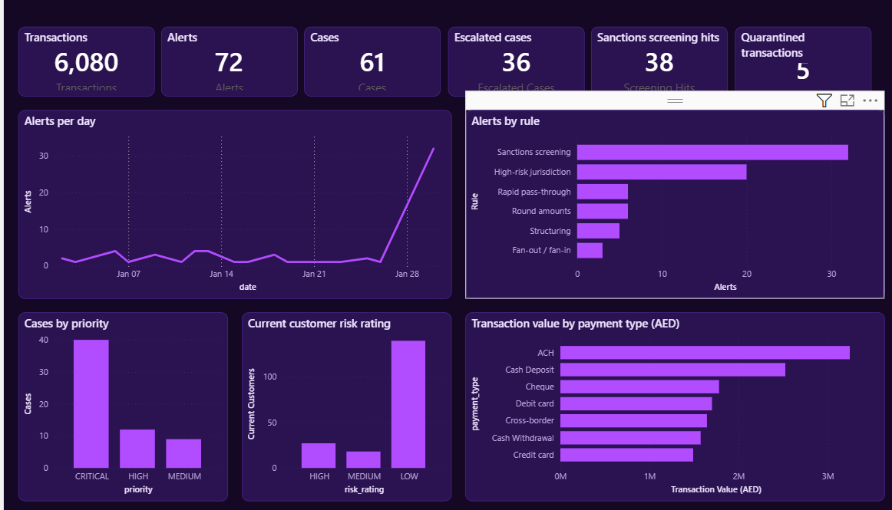
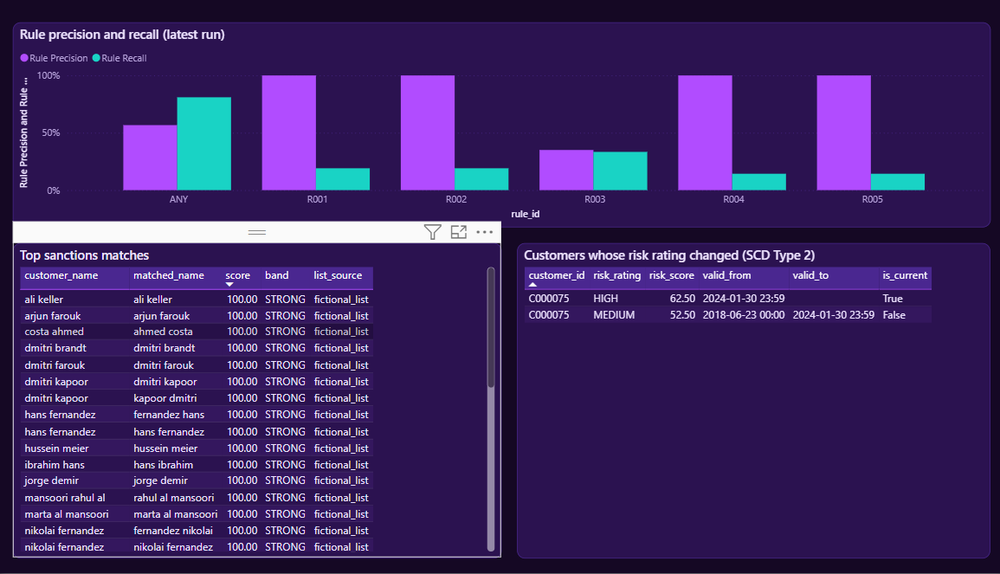
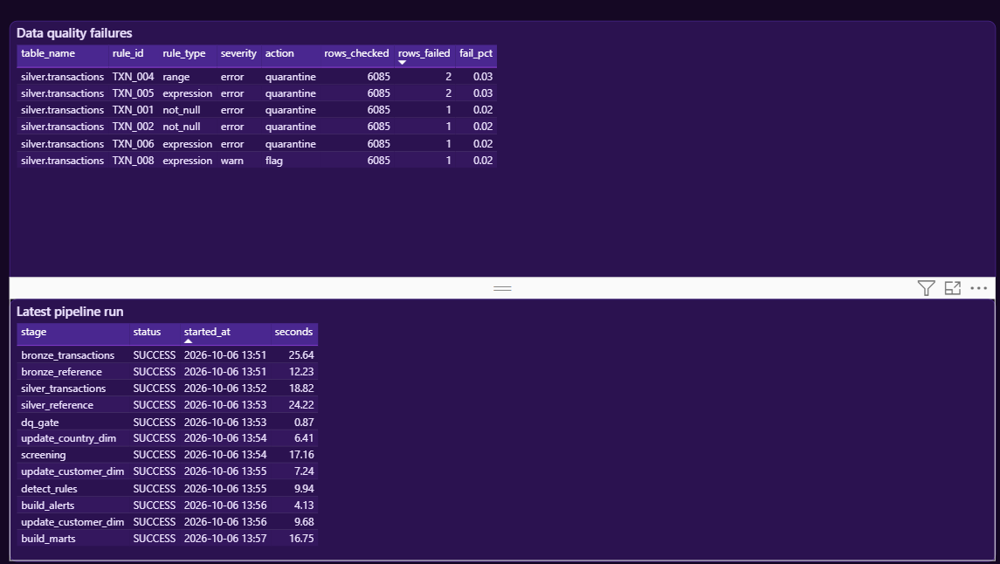
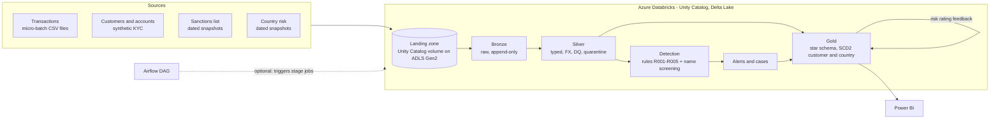

# AML Monitoring Lakehouse

An end-to-end anti-money-laundering (AML) monitoring platform on **Azure Databricks**. It ingests transactions,
cleans and validates them, runs behavioural detection rules and fuzzy sanctions screening, builds alerts and cases,
and serves the results to a **Power BI** dashboard.

It runs fully on synthetic data. The same code runs locally (Spark and parquet, no cloud account) and on Azure
Databricks (Delta Lake, Unity Catalog, Auto Loader, serverless compute).

**Contents:** [Dashboard](#power-bi-dashboard) · [Architecture](#architecture) · [Dataset](#dataset) · [How the pipeline works](#how-the-pipeline-works) · [Run it](#run-it) · [Project structure](#project-structure) · [Detection rules](#detection-rules) · [Status and limitations](#status-and-limitations)

---

## Power BI dashboard

A three-page Power BI report reads the Gold and ops tables from Databricks. The project is generated as code, so it
can be rebuilt at any time.

**Overview** – volumes, alerts per day and by rule, cases by priority, customer risk, value by payment type


**Detection quality** – rule precision and recall, top sanctions matches, customers whose risk rating changed (SCD Type 2)


**Pipeline health** – data-quality failures and the latest pipeline run


### Open it

1. Install Power BI Desktop (free). Enable the **Power BI Project (.pbip)** and **TMDL** preview features if prompted.
2. Open `powerbi/AML.pbip`.
3. **Transform data > Edit parameters**: replace the placeholders `DatabricksHost` (workspace hostname, no `https://`) and
   `DatabricksHttpPath` (SQL warehouse > Connection details, for example `/sql/1.0/warehouses/<id>`).
4. **Refresh**. When asked for credentials choose **Personal Access Token** (Databricks > Settings > Developer >
   Access tokens). The SQL warehouse starts only for the refresh.

To regenerate the project after schema changes (this overwrites the `powerbi/` folder; `--host` and `--http-path` are
optional and default to the placeholders above):

```bash
python scripts/generate_powerbi_project.py --host <workspace-host> --http-path /sql/1.0/warehouses/<id>
```

On Windows Git Bash, prefix that command with `MSYS_NO_PATHCONV=1` or the leading `/` of the HTTP path gets rewritten.

Publishing to the Power BI service needs a work or school account; the report works in Desktop with any account.

---

## Architecture



### Azure resources

`infra/azure/01_provision.ps1` creates these; `99_teardown.ps1` deletes them.

| Resource | Purpose |
|---|---|
| Resource group | Container for everything below |
| Storage account (ADLS Gen2, hierarchical namespace) | `landing` and `lake` containers backing Unity Catalog |
| Azure Databricks workspace (Premium) | Runs the jobs, hosts Unity Catalog and the SQL warehouse |
| Access connector (managed identity) | Lets Unity Catalog reach the storage account (Storage Blob Data Contributor) |

Inside Databricks: a **storage credential** (the access connector), an **external location** on the `lake` container, a
catalog `aml` with Bronze, Silver, Gold and ops schemas, and a `landing` schema with two volumes (`files` for input data,
`checkpoints` for streaming state). Jobs run on **serverless compute**, so there is no cluster to size or keep running.

### Design decisions

1. **Store abstraction.** Stages read and write logical table names. `ParquetStore` runs and tests the pipeline without
   Databricks; `DeltaStore` adds MERGE-based idempotent loads and SCD2 on Databricks.
2. **One source of truth for tables.** `src/aml/schemas.py` generates the DDL, the data model docs and the Power BI model.
3. **Streaming scope.** Bronze ingestion uses Auto Loader with an `availableNow` trigger. Silver and detection are
   incremental micro-batches (watermark plus lookback), not stateful streaming.
4. **Logical time.** SCD2 timestamps use the latest event time processed, so replayed history produces coherent versions
   and point-in-time joins.
5. **Labels are for evaluation only.** `is_laundering` is carried through for metrics but never read by rules or screening.
6. **Feedback loop.** Alerts and screening hits raise customer risk scores. Rating changes create SCD2 versions, and later
   alerts join the version in force when they were raised.
7. **Idempotency.** Loads are insert-only on deterministic ids, so a second run changes no business tables.

---

## Dataset

The default run uses **synthetic data generated by `scripts/generate_sample_data.py`**. Nothing is downloaded.

| Dataset | Volume (default) | Notes |
|---|---|---|
| Transactions | about 6,100 over January 2024 | Normal activity plus injected laundering patterns, in the SAML-D column layout |
| Customers and accounts | about 185 customers, 300 accounts | Synthetic KYC records |
| Sanctions list | 240 entries | **Fictional** names; any resemblance to real people is coincidental |
| Country risk | 10 countries | Demo tiers for illustration only |
| FX rates | `reference/fx_rates_illustrative.csv` | Placeholder rates to AED |
| Ground truth | `data/ground_truth/` | Seeded screening matches, used only for evaluation |

Real datasets (SAML-D, IBM AMLworld, OFAC, FATF and others) are supported or planned, but licences and formats must be
checked first. See [docs/data_sources.md](docs/data_sources.md).

---

## How the pipeline works

Stages run in this order (`aml.jobs.stages`). Locally they run through `aml.jobs.local_pipeline`; on Databricks through
the `aml-full-pipeline` job.

| # | Stage | What it does |
|---|---|---|
| 0 | `init_tables` | Creates schemas and Delta tables with column comments (Databricks only) |
| 1 | `bronze_transactions` | Ingests landing CSVs into `bronze.transactions_raw` (Auto Loader), append-only, with lineage columns |
| 2 | `bronze_reference` | Batch-loads customers, accounts, sanctions and country risk (new files only) |
| 3 | `silver_transactions` | Casts types safely, deduplicates, converts to AED, applies data-quality rules; failing rows go to quarantine |
| 4 | `silver_reference` | Cleans customers, accounts and sanctions entries |
| 5 | `dq_gate` | Fails the run if error-level failure rates exceed thresholds in `config/dq_rules.yml` |
| 6 | `update_country_dim` | Maintains the country risk dimension as SCD Type 2 |
| 7 | `screening` | Fuzzy name matching of customers against the sanctions list (phonetic and affix blocking, Jaro-Winkler / token-sort scoring) |
| 8 | `update_customer_dim` (initial) | Creates the first SCD2 customer versions |
| 9 | `detect_rules` | Runs the five behavioural rules over a lookback window |
| 10 | `build_alerts` | Builds alerts and weekly cases with deterministic ids |
| 11 | `update_customer_dim` (feedback) | Alerts and hits update risk ratings, producing SCD2 history |
| 12 | `build_marts` | Builds Gold facts and the rule precision and recall mart |

Medallion layers: **Bronze** is raw and append-only. **Silver** is typed, deduplicated, validated and FX-converted, with a
quarantine table. **Gold** is a star schema (`dim_customer`, `dim_country`, `dim_account`, `dim_date`, `dim_rule`,
`fact_transaction`, `fact_alert`, `fact_case`, `fact_screening`, `mart_rule_performance`). All 24 tables are documented in
[docs/data_model.md](docs/data_model.md).

On the bundled sample the Databricks run produces 6,080 Silver transactions (plus 5 quarantined), 72 alerts, 61 cases and
38 screening hits.

---

## Run it

### Prerequisites

| For | You need |
|---|---|
| Local run | Python 3.10+, Java 17+ (Spark) |
| Azure Databricks | An Azure subscription, [Azure CLI](https://learn.microsoft.com/cli/azure/install-azure-cli), [Databricks CLI](https://docs.databricks.com/dev-tools/cli/install.html), `pip install build` |
| Dashboard | Power BI Desktop |

### A. Locally (no cloud account)

```bash
python -m venv .venv && source .venv/bin/activate      # Windows: .venv\Scripts\activate
pip install -e ".[dev]"
make sample-data      # synthetic landing files into data/landing
make local-run        # whole pipeline on local Spark, parquet tables
make report           # counts, DQ failures, rule and screening metrics, SCD2 history
make test
```

### B. On Azure Databricks

**1. Provision Azure** (sign in with `az login` first; pick any region that allows Databricks for your subscription):

```powershell
az account set --subscription <subscription-id>
powershell -ExecutionPolicy Bypass -File .\infra\azure\01_provision.ps1 -Location <region>
```

The script stops on the first failed step and writes the workspace URL, storage account and access connector ID to
`infra/azure/azure_outputs.json`. Run it as a file; do not paste it into a terminal.

**2. Set up Unity Catalog** in the workspace UI:

1. Catalog > Credentials > **Create credential**: type *Azure Managed Identity*, name `aml_cred`, paste the access connector ID.
2. Catalog > External Locations > **Create**: name `aml_lake`, URL `abfss://lake@<storage-account>.dfs.core.windows.net/`,
   credential `aml_cred`. If it warns about file events, choose *Force create* (optional feature).
3. In the SQL Editor (a serverless or starter warehouse is fine) run:

```sql
CREATE CATALOG IF NOT EXISTS aml
  MANAGED LOCATION 'abfss://lake@<storage-account>.dfs.core.windows.net/aml';
CREATE SCHEMA IF NOT EXISTS aml.landing;
CREATE VOLUME IF NOT EXISTS aml.landing.files;
CREATE VOLUME IF NOT EXISTS aml.landing.checkpoints;
```

**3. Connect the Databricks CLI.** `databricks.yml` contains no workspace host; the CLI profile supplies it:

```bash
databricks auth login --host https://<your-workspace>.azuredatabricks.net
```

Accept or choose a profile name, then add `-p <profile>` to every `databricks` command below (or set `DATABRICKS_CONFIG_PROFILE`).

**4. Deploy and run:**

```bash
databricks bundle validate -t dev
databricks bundle deploy -t dev                                      # builds the wheel and creates the jobs
databricks bundle run aml_stage_runner -t dev                        # init_tables: creates the Delta tables
make sample-data
databricks fs cp -r data/landing dbfs:/Volumes/aml/landing/files --overwrite
databricks bundle run aml_full_pipeline -t dev                       # all pipeline stages in order
```

The bundle defines three jobs, all on serverless compute: `aml-stage-runner` (one stage, default `init_tables`),
`aml-full-pipeline` (every stage in order) and `aml-stream-ingest` (continuous Auto Loader job, paused by default).
Settings reach the code as task parameters, since serverless jobs cannot set environment variables.

**5. Build the dashboard** as described in [Power BI dashboard](#open-it).

**6. Clean up** when finished: terminate the SQL warehouse and run `infra/azure/99_teardown.ps1`.

> Free-trial subscriptions often have low vCPU quotas and occasional regional VM stockouts. Serverless compute avoids both.

### C. Optional: Grafana on local data

A second dashboard (PostgreSQL and Grafana in Docker) reads the local parquet output:

```bash
pip install -e ".[dashboard]"
docker compose -f dashboard/docker-compose.yml up -d     # Postgres :5433, Grafana :3000
python -m aml.jobs.export_to_postgres                    # copy Gold and ops tables after each local run
```

Open http://localhost:3000 (admin / admin). The sample data covers January 2024, so keep the time range on that month.

### D. Optional: Airflow orchestration

`airflow/dags/aml_batch_dag.py` triggers one Databricks job run per stage. It has only been syntax-checked.

---

## Project structure

```
aml-monitoring-lakehouse/
├── src/aml/                  Pipeline package
│   ├── schemas.py            Table registry: single source of truth for DDL, docs, Power BI model
│   ├── store.py              ParquetStore (local) and DeltaStore (Databricks)
│   ├── config.py             Settings from environment variables and task parameters
│   ├── ingestion/            Bronze readers (CSV, Auto Loader, OFAC)
│   ├── transform/            Silver cleaning, name normalisation, SCD2
│   ├── quality/              Metadata-driven data-quality framework
│   ├── detection/            Rules R001-R005 and fuzzy sanctions screening
│   ├── alerts/               Alert and case building
│   ├── evaluation/           Precision and recall against ground truth
│   ├── generators/           Synthetic data and replay
│   ├── jobs/                 Stage functions, aml-stage entry point, local runner, report
│   └── common/               Spark session and logging helpers
├── config/                   rules.yml, dq_rules.yml, screening.yml, source profile, country risk
├── databricks.yml            Databricks Asset Bundle: serverless jobs
├── infra/azure/              Provision and teardown scripts
├── powerbi/                  Power BI Project (semantic model and report)
├── screenshots/              Dashboard screenshots used in this README
├── dashboard/                Optional Grafana and PostgreSQL stack
├── airflow/dags/             Optional Airflow DAG
├── sql/                      Generated DDL and example analytics queries
├── scripts/                  Sample data, docs and Power BI project generators
├── reference/                Illustrative FX rates
├── docs/                     Architecture, data model, rules, data sources, limitations
├── tests/                    Unit and end-to-end tests
├── .github/workflows/        CI and a manual deploy workflow
├── pyproject.toml            Package and dependencies
└── Makefile                  Common tasks
```

---

## Detection rules

Thresholds live in `config/rules.yml` and are **illustrative, not regulatory values**.

| Rule | Typology |
|---|---|
| R001 | Structuring: repeated just-below-threshold transactions |
| R002 | Rapid pass-through of funds |
| R003 | High-risk jurisdiction exposure, using the country tier in force at event time |
| R004 | Fan-out and fan-in to many counterparties |
| R005 | Repeated round-amount transfers |
| S001 | Sanctions screening: name similarity, REVIEW from 80 and STRONG from 92 |

Full logic, parameters and known limits are in [docs/rules_catalogue.md](docs/rules_catalogue.md). On the synthetic sample,
any-rule precision is 0.57 and recall 0.81 against originator accounts. These numbers describe synthetic data seeded with
these patterns and say nothing about real-world performance.

---

## Status and limitations

| Area | Status |
|---|---|
| Pipeline logic, rules, screening, SCD2, data quality, alerts and cases | Implemented and tested locally |
| Delta store, Auto Loader, `init_tables`, Databricks Asset Bundle, serverless jobs | Run end to end on Azure Databricks |
| Power BI report | Built and refreshed against Databricks |
| Grafana dashboard | Written to read local data; not re-run alongside the Azure work |
| Airflow DAG, GitHub deploy workflow | Written, not executed |
| IBM AMLworld adapter, stateful streaming, ML scoring | Not implemented |

Before using real data read [docs/data_sources.md](docs/data_sources.md) and
[docs/assumptions_and_limitations.md](docs/assumptions_and_limitations.md). In short: dataset column names and licences
must be verified, FX rates are placeholders, case workflow is simulated, name screening is name-only, and all thresholds
are illustrative.

---

Code is MIT licensed. Datasets carry their own licences.
