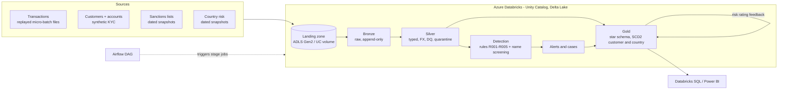

# Architecture

## Overview

## Components

| Component | Implementation | Status |
|---|---|---|
| Landing | Files in a Unity Catalog volume (ADLS Gen2) or local `data/landing` | Verified locally and on Databricks |
| Bronze streaming | Auto Loader (`cloudFiles`) on Databricks, file stream locally, `availableNow` trigger | Verified locally and on Databricks |
| Silver | Source-profile adapter, ANSI-safe casts, dedupe, FX, metadata-driven DQ with quarantine | Verified locally |
| Incremental processing | `ops.watermarks` on `_ingested_at` (silver) and event time with lookback (rules) | Verified locally |
| Gold | Star schema; SCD2 on `dim_customer` and `dim_country` | Parquet path and Delta MERGE verified |
| Detection | Five windowed rules and fuzzy sanctions screening | Verified locally |
| Alerts and cases | Deterministic alert ids, point-in-time customer key, weekly cases | Verified locally |
| Orchestration | Airflow DAG triggering one Databricks job per stage | Syntax-checked only |
| Deployment | Databricks Asset Bundle (serverless jobs), GitHub Actions | Bundle validated, deployed and run; GitHub workflow not run |

## Design decisions

1. **Store abstraction.** Stages read and write logical table names via `Store`. `ParquetStore` makes the whole pipeline runnable and testable without Databricks; `DeltaStore` provides MERGE-based idempotent loads and SCD2 on Databricks.
2. **Single source of truth for tables.** `src/aml/schemas.py` generates DDL and the data model docs; CI fails if they drift.
3. **Streaming scope.** Streaming is used for Bronze ingestion. Silver and detection run as incremental micro-batches (watermark plus lookback) triggered by Airflow. This is not stateful streaming; per-account rolling state is recomputed over a lookback window.
4. **Logical time.** SCD2 effective timestamps use the latest event time processed, not wall-clock time, so replayed historical data produces coherent history and point-in-time joins.
5. **Labels are for evaluation only.** `is_laundering` is carried to Silver and Gold for metrics but never read by rules or screening.
6. **Feedback loop.** Alerts and screening hits feed the customer risk score; rating changes create SCD2 versions; later alerts join the version in force at alert time.
7. **Idempotency.** Insert-only loads keyed on deterministic ids; a second run changes no business tables (tested).

## Run modes

| Mode | Store | Ingestion | How |
|---|---|---|---|
| Local | parquet | file stream | `make sample-data && make local-run` |
| Databricks | Delta (Unity Catalog) | Auto Loader | `databricks bundle deploy`, Airflow DAG |
