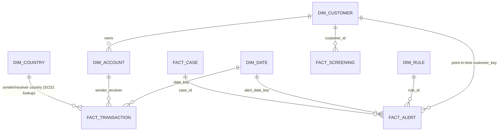

# Data model

Generated by `scripts/generate_docs.py` from `src/aml/schemas.py`. Do not edit by hand.

24 tables across four schemas. Unity Catalog names are `<catalog>.<schema>.<table>`; local runs use parquet under `data/lake/<schema>/<table>`.

## Gold star schema

SCD Type 2 dimensions: `gold.dim_customer` (profile and risk rating) and `gold.dim_country` (risk tier). `fact_alert.customer_key` is a point-in-time join (`valid_from <= alert_ts < valid_to`).

## Tables

| Table | Layer | Grain / primary key | Load pattern |
|---|---|---|---|
| `bronze.transactions_raw` | bronze | `_source_file`, `Sender_account`, `Receiver_account`, `Date`, `Time`, `Amount` | Append-only stream (Auto Loader or file stream, availableNow trigger) |
| `bronze.customers_raw` | bronze | `customer_id`, `_source_file` | Batch, new files only (anti-join on _source_file) |
| `bronze.accounts_raw` | bronze | `account_id`, `_source_file` | Batch, new files only (anti-join on _source_file) |
| `bronze.sanctions_raw` | bronze | `list_source`, `snapshot_date`, `ent_num`, `alt_num`, `name` | Batch, new files only; every snapshot is kept |
| `bronze.country_risk_raw` | bronze | `country`, `effective_date`, `_source_file` | Batch, new files only |
| `silver.transactions` | silver | `transaction_id` | Incremental on _ingested_at watermark; insert-only on transaction_id |
| `silver.transactions_quarantine` | silver | `transaction_id`, `run_id` | Append per run |
| `silver.customers` | silver | `customer_id` | Overwrite from latest Bronze snapshot |
| `silver.accounts` | silver | `account_id` | Overwrite from Bronze |
| `silver.sanctions_entries` | silver | `entry_id`, `snapshot_date` | Insert-only on (entry_id, snapshot_date) |
| `silver.rule_hits` | silver | `hit_id` | Incremental with lookback; insert-only on hit_id |
| `gold.dim_customer` | gold | `customer_key` | SCD2: MERGE on Delta, rebuild for local parquet |
| `gold.dim_country` | gold | `country_key` | SCD2 |
| `gold.dim_account` | gold | `account_id` | Overwrite |
| `gold.dim_date` | gold | `date_key` | Overwrite over the data date range |
| `gold.dim_rule` | gold | `rule_id` | Overwrite |
| `gold.fact_transaction` | gold | `transaction_id` | Insert-only on transaction_id |
| `gold.fact_screening` | gold | `screening_id` | Insert-only on screening_id |
| `gold.fact_alert` | gold | `alert_id` | Insert-only on alert_id |
| `gold.fact_case` | gold | `case_id` | Rebuilt each run from fact_alert |
| `gold.mart_rule_performance` | gold | `run_id`, `rule_id` | Append per run |
| `ops.dq_results` | ops | `run_id`, `table_name`, `rule_id` | Append per run |
| `ops.watermarks` | ops | `pipeline` | Overwrite |
| `ops.pipeline_runs` | ops | `run_id`, `stage` | Append |

## Bronze (raw)

### `bronze.transactions_raw`

Raw transactions exactly as received (SAML-D column layout), all strings.

*Key:* `_source_file`, `Sender_account`, `Receiver_account`, `Date`, `Time`, `Amount`  
*Load:* Append-only stream (Auto Loader or file stream, availableNow trigger)

| Column | Type | Description |
|---|---|---|
| `Time` | `string` | Source time of day |
| `Date` | `string` | Source date |
| `Sender_account` | `string` | Sender account id |
| `Receiver_account` | `string` | Receiver account id |
| `Amount` | `string` | Amount in the payment currency |
| `Payment_currency` | `string` | Currency sent |
| `Received_currency` | `string` | Currency received |
| `Sender_bank_location` | `string` | Sender bank country |
| `Receiver_bank_location` | `string` | Receiver bank country |
| `Payment_type` | `string` | Payment channel |
| `Is_laundering` | `string` | Ground-truth label (evaluation only, never used in detection) |
| `Laundering_type` | `string` | Ground-truth typology (evaluation only) |
| `_source_file` | `string` | Landing file the row came from |
| `_ingested_at` | `timestamp` | Time the row was ingested into Bronze |

### `bronze.customers_raw`

Raw synthetic KYC customer snapshots, all strings.

*Key:* `customer_id`, `_source_file`  
*Load:* Batch, new files only (anti-join on _source_file)

| Column | Type | Description |
|---|---|---|
| `customer_id` | `string` | Customer identifier |
| `full_name` | `string` | Customer name as captured |
| `date_of_birth` | `string` | Date of birth (ISO) |
| `nationality` | `string` | Nationality |
| `residence_country` | `string` | Country of residence |
| `occupation` | `string` | Occupation |
| `onboarding_date` | `string` | Onboarding date (ISO) |
| `_source_file` | `string` | Landing file the row came from |
| `_ingested_at` | `timestamp` | Time the row was ingested into Bronze |

### `bronze.accounts_raw`

Raw account-to-customer mapping, all strings.

*Key:* `account_id`, `_source_file`  
*Load:* Batch, new files only (anti-join on _source_file)

| Column | Type | Description |
|---|---|---|
| `account_id` | `string` | Account identifier |
| `customer_id` | `string` | Owning customer |
| `account_open_date` | `string` | Account opening date (ISO) |
| `_source_file` | `string` | Landing file the row came from |
| `_ingested_at` | `timestamp` | Time the row was ingested into Bronze |

### `bronze.sanctions_raw`

Dated sanctions-list snapshots in canonical layout, all strings.

*Key:* `list_source`, `snapshot_date`, `ent_num`, `alt_num`, `name`  
*Load:* Batch, new files only; every snapshot is kept

| Column | Type | Description |
|---|---|---|
| `list_source` | `string` | List identifier, e.g. ofac_sdn |
| `snapshot_date` | `string` | Snapshot date taken from the landing path |
| `record_type` | `string` | primary or alias |
| `ent_num` | `string` | List entry number |
| `alt_num` | `string` | Alias number, null for primary names |
| `name` | `string` | Listed name or alias |
| `entity_type` | `string` | individual, entity, vessel, ... |
| `program` | `string` | Sanctions programme |
| `remarks` | `string` | Free-text remarks |
| `_source_file` | `string` | Landing file the row came from |
| `_ingested_at` | `timestamp` | Time the row was ingested into Bronze |

### `bronze.country_risk_raw`

Dated country-risk list snapshots, all strings.

*Key:* `country`, `effective_date`, `_source_file`  
*Load:* Batch, new files only

| Column | Type | Description |
|---|---|---|
| `country` | `string` | Country name as used in the transaction source |
| `risk_tier` | `string` | LOW, MEDIUM or HIGH |
| `source_list` | `string` | Originating list, e.g. FATF call for action |
| `effective_date` | `string` | Date the classification took effect |
| `_source_file` | `string` | Landing file the row came from |
| `_ingested_at` | `timestamp` | Time the row was ingested into Bronze |

## Silver (validated)

### `silver.transactions`

Typed, deduplicated, validated transactions with AED amounts.

*Key:* `transaction_id`  
*Load:* Incremental on _ingested_at watermark; insert-only on transaction_id

| Column | Type | Description |
|---|---|---|
| `transaction_id` | `string` | Deterministic hash of the natural transaction fields |
| `event_ts` | `timestamp` | Transaction timestamp (UTC) |
| `event_date` | `date` | Transaction date |
| `sender_account` | `string` | Sender account id |
| `receiver_account` | `string` | Receiver account id |
| `amount_original` | `double` | Amount in the sent currency |
| `currency_sent` | `string` | ISO currency sent |
| `currency_received` | `string` | ISO currency received |
| `amount_aed` | `double` | Amount converted to AED |
| `sender_country` | `string` | Sender bank country (upper case) |
| `receiver_country` | `string` | Receiver bank country (upper case) |
| `payment_type` | `string` | Payment channel |
| `is_laundering` | `int` | Ground-truth label, evaluation only |
| `laundering_type` | `string` | Ground-truth typology, evaluation only |
| `_ingested_at` | `timestamp` | Bronze ingestion time (incremental watermark) |

### `silver.transactions_quarantine`

Transactions that failed an error-level data quality rule, with the failed rule ids.

*Key:* `transaction_id`, `run_id`  
*Load:* Append per run

| Column | Type | Description |
|---|---|---|
| `transaction_id` | `string` | Deterministic hash of the natural transaction fields |
| `event_ts` | `timestamp` | Transaction timestamp (UTC) |
| `event_date` | `date` | Transaction date |
| `sender_account` | `string` | Sender account id |
| `receiver_account` | `string` | Receiver account id |
| `amount_original` | `double` | Amount in the sent currency |
| `currency_sent` | `string` | ISO currency sent |
| `currency_received` | `string` | ISO currency received |
| `amount_aed` | `double` | Amount converted to AED |
| `sender_country` | `string` | Sender bank country (upper case) |
| `receiver_country` | `string` | Receiver bank country (upper case) |
| `payment_type` | `string` | Payment channel |
| `is_laundering` | `int` | Ground-truth label, evaluation only |
| `laundering_type` | `string` | Ground-truth typology, evaluation only |
| `_ingested_at` | `timestamp` | Bronze ingestion time (incremental watermark) |
| `raw_event_ts` | `string` | Original timestamp text |
| `raw_amount` | `string` | Original amount text |
| `dq_failed_rules` | `array<string>` | Ids of the rules the row failed |
| `quarantined_at` | `timestamp` | Quarantine time |
| `run_id` | `string` | Pipeline run id |

### `silver.customers`

Latest standardised customer snapshot with normalised name.

*Key:* `customer_id`  
*Load:* Overwrite from latest Bronze snapshot

| Column | Type | Description |
|---|---|---|
| `customer_id` | `string` | Customer identifier |
| `full_name` | `string` | Customer name |
| `name_norm` | `string` | Normalised name used for screening |
| `date_of_birth` | `date` | Date of birth |
| `nationality` | `string` | Nationality (upper case) |
| `residence_country` | `string` | Country of residence (upper case) |
| `occupation` | `string` | Occupation |
| `onboarding_date` | `date` | Onboarding date |

### `silver.accounts`

Account-to-customer mapping.

*Key:* `account_id`  
*Load:* Overwrite from Bronze

| Column | Type | Description |
|---|---|---|
| `account_id` | `string` | Account identifier |
| `customer_id` | `string` | Owning customer |
| `account_open_date` | `date` | Account opening date |

### `silver.sanctions_entries`

Normalised sanctions entries, all snapshots. Screening uses the latest snapshot per list.

*Key:* `entry_id`, `snapshot_date`  
*Load:* Insert-only on (entry_id, snapshot_date)

| Column | Type | Description |
|---|---|---|
| `entry_id` | `string` | list_source|ent_num|alt_num |
| `list_source` | `string` | List identifier |
| `ent_num` | `string` | List entry number |
| `record_type` | `string` | primary or alias |
| `name` | `string` | Listed name or alias |
| `name_norm` | `string` | Normalised name |
| `entity_type` | `string` | Entity type |
| `program` | `string` | Sanctions programme |
| `snapshot_date` | `date` | Snapshot date |

### `silver.rule_hits`

Raw behavioural rule hits before alert construction.

*Key:* `hit_id`  
*Load:* Incremental with lookback; insert-only on hit_id

| Column | Type | Description |
|---|---|---|
| `hit_id` | `string` | Hash of rule, account and date |
| `rule_id` | `string` | Rule identifier |
| `account_id` | `string` | Account that triggered the rule |
| `transaction_id` | `string` | Representative transaction, null for account-level hits |
| `event_ts` | `timestamp` | Event time of the hit |
| `score` | `double` | Rule score between 0 and 1 |
| `evidence` | `string` | JSON evidence |
| `run_id` | `string` | Pipeline run id |

## Gold (serving)

### `gold.dim_customer`

Customer dimension, SCD Type 2 on risk and profile attributes.

*Key:* `customer_key`  
*Load:* SCD2: MERGE on Delta, rebuild for local parquet

| Column | Type | Description |
|---|---|---|
| `customer_key` | `bigint` | Surrogate key (hash of customer_id and valid_from) |
| `customer_id` | `string` | Natural key |
| `full_name` | `string` | Customer name |
| `name_norm` | `string` | Normalised name |
| `date_of_birth` | `date` | Date of birth |
| `nationality` | `string` | Nationality |
| `residence_country` | `string` | Country of residence |
| `occupation` | `string` | Occupation |
| `onboarding_date` | `date` | Onboarding date |
| `risk_score` | `double` | Derived customer risk score (illustrative weights) |
| `risk_rating` | `string` | LOW, MEDIUM or HIGH |
| `row_hash` | `string` | Hash of tracked attributes for change detection |
| `valid_from` | `timestamp` | Version start (logical time) |
| `valid_to` | `timestamp` | Version end, null while current |
| `is_current` | `boolean` | True for the current version |

### `gold.dim_country`

Country risk dimension, SCD Type 2 on risk tier.

*Key:* `country_key`  
*Load:* SCD2

| Column | Type | Description |
|---|---|---|
| `country_key` | `bigint` | Surrogate key |
| `country` | `string` | Country name as used in the transaction source |
| `risk_tier` | `string` | LOW, MEDIUM or HIGH |
| `source_list` | `string` | Originating list |
| `row_hash` | `string` | Hash of tracked attributes |
| `valid_from` | `timestamp` | Version start |
| `valid_to` | `timestamp` | Version end, null while current |
| `is_current` | `boolean` | True for the current version |

### `gold.dim_account`

Account dimension (SCD Type 1).

*Key:* `account_id`  
*Load:* Overwrite

| Column | Type | Description |
|---|---|---|
| `account_id` | `string` | Account identifier |
| `customer_id` | `string` | Owning customer |
| `account_open_date` | `date` | Account opening date |

### `gold.dim_date`

Calendar dimension.

*Key:* `date_key`  
*Load:* Overwrite over the data date range

| Column | Type | Description |
|---|---|---|
| `date_key` | `int` | yyyymmdd |
| `date` | `date` | Calendar date |
| `year` | `int` | Year |
| `quarter` | `int` | Quarter |
| `month` | `int` | Month |
| `day` | `int` | Day of month |
| `day_of_week` | `int` | 1 = Sunday ... 7 = Saturday (Spark dayofweek) |
| `is_weekend` | `boolean` | Saturday or Sunday |

### `gold.dim_rule`

Detection rule catalogue generated from config/rules.yml.

*Key:* `rule_id`  
*Load:* Overwrite

| Column | Type | Description |
|---|---|---|
| `rule_id` | `string` | Rule identifier |
| `rule_name` | `string` | Short name |
| `typology` | `string` | Money laundering typology |
| `description` | `string` | What the rule detects |
| `enabled` | `boolean` | Whether the rule is active |
| `parameters` | `string` | JSON parameters (illustrative thresholds) |

### `gold.fact_transaction`

Transaction fact (grain: one transaction).

*Key:* `transaction_id`  
*Load:* Insert-only on transaction_id

| Column | Type | Description |
|---|---|---|
| `transaction_id` | `string` | Degenerate key |
| `date_key` | `int` | FK to dim_date |
| `event_ts` | `timestamp` | Transaction timestamp |
| `sender_account` | `string` | FK to dim_account |
| `receiver_account` | `string` | FK to dim_account |
| `sender_country` | `string` | Sender bank country |
| `receiver_country` | `string` | Receiver bank country |
| `payment_type` | `string` | Payment channel |
| `amount_aed` | `double` | Amount in AED |
| `is_laundering` | `int` | Ground-truth label, evaluation only |

### `gold.fact_screening`

Sanctions screening results at review or strong level.

*Key:* `screening_id`  
*Load:* Insert-only on screening_id

| Column | Type | Description |
|---|---|---|
| `screening_id` | `string` | Hash of customer, entry and list snapshot |
| `customer_id` | `string` | Screened customer |
| `entry_id` | `string` | Matched list entry |
| `list_source` | `string` | List identifier |
| `customer_name` | `string` | Normalised customer name |
| `matched_name` | `string` | Normalised listed name |
| `score` | `double` | Similarity score 0-100 |
| `band` | `string` | REVIEW or STRONG |
| `list_snapshot_date` | `date` | Snapshot the match was made against |
| `scored_at` | `timestamp` | Logical time of scoring |
| `run_id` | `string` | Pipeline run id |

### `gold.fact_alert`

Alerts from behavioural rules and sanctions screening.

*Key:* `alert_id`  
*Load:* Insert-only on alert_id

| Column | Type | Description |
|---|---|---|
| `alert_id` | `string` | Deterministic alert id (idempotent re-runs) |
| `alert_type` | `string` | BEHAVIOURAL or SCREENING |
| `rule_id` | `string` | Rule id, S001 for screening |
| `alert_ts` | `timestamp` | Event time of the alert |
| `alert_date_key` | `int` | FK to dim_date |
| `customer_id` | `string` | Customer the alert relates to |
| `customer_key` | `bigint` | Point-in-time FK to dim_customer |
| `risk_rating_at_alert` | `string` | Customer rating in force at alert time |
| `account_id` | `string` | Account, null for screening alerts |
| `transaction_id` | `string` | Representative transaction, may be null |
| `score` | `double` | Score between 0 and 1 |
| `band` | `string` | REVIEW or STRONG for screening, null otherwise |
| `evidence` | `string` | JSON evidence |
| `status` | `string` | NEW at creation |
| `case_id` | `string` | Case the alert belongs to |
| `run_id` | `string` | Pipeline run id |

### `gold.fact_case`

Cases grouping alerts per customer per week. Workflow fields are SIMULATED in this repository.

*Key:* `case_id`  
*Load:* Rebuilt each run from fact_alert

| Column | Type | Description |
|---|---|---|
| `case_id` | `string` | Hash of customer and week |
| `customer_id` | `string` | Customer |
| `customer_key` | `bigint` | Point-in-time customer key of the first alert |
| `risk_rating` | `string` | Rating at the first alert |
| `opened_ts` | `timestamp` | Earliest alert time |
| `priority` | `string` | CRITICAL, HIGH, MEDIUM or LOW |
| `status` | `string` | OPEN, IN_REVIEW or CLOSED |
| `alert_count` | `int` | Number of alerts in the case |
| `max_score` | `double` | Highest alert score |
| `assigned_to` | `string` | Simulated analyst |
| `disposition` | `string` | Simulated outcome: ESCALATED or FALSE_POSITIVE |
| `closed_ts` | `timestamp` | Simulated closure time |

### `gold.mart_rule_performance`

Rule precision and recall at account level against ground-truth labels.

*Key:* `run_id`, `rule_id`  
*Load:* Append per run

| Column | Type | Description |
|---|---|---|
| `run_id` | `string` | Pipeline run id |
| `rule_id` | `string` | Rule id or ANY |
| `alerted_accounts` | `bigint` | Distinct accounts alerted |
| `true_positive_accounts` | `bigint` | Alerted accounts that are laundering accounts |
| `positive_accounts` | `bigint` | All laundering accounts |
| `precision` | `double` | True positives divided by alerted accounts |
| `recall` | `double` | True positives divided by positive accounts |
| `computed_at` | `timestamp` | Computation time |

## Operations

### `ops.dq_results`

Data quality results per rule per run.

*Key:* `run_id`, `table_name`, `rule_id`  
*Load:* Append per run

| Column | Type | Description |
|---|---|---|
| `run_id` | `string` | Pipeline run id |
| `table_name` | `string` | Table validated |
| `rule_id` | `string` | Rule identifier |
| `rule_type` | `string` | not_null, unique, range, in_set, regex or expression |
| `severity` | `string` | error or warn |
| `action` | `string` | quarantine or flag |
| `rows_checked` | `bigint` | Rows evaluated |
| `rows_failed` | `bigint` | Rows that failed |
| `fail_pct` | `double` | Failure percentage |
| `checked_at` | `timestamp` | Check time |

### `ops.watermarks`

Incremental processing watermarks.

*Key:* `pipeline`  
*Load:* Overwrite

| Column | Type | Description |
|---|---|---|
| `pipeline` | `string` | Watermark name |
| `watermark` | `timestamp` | Last processed timestamp |
| `updated_at` | `timestamp` | Update time |

### `ops.pipeline_runs`

Stage execution log.

*Key:* `run_id`, `stage`  
*Load:* Append

| Column | Type | Description |
|---|---|---|
| `run_id` | `string` | Pipeline run id |
| `stage` | `string` | Stage name |
| `started_at` | `timestamp` | Start time |
| `finished_at` | `timestamp` | End time |
| `status` | `string` | SUCCESS or FAILED |
| `message` | `string` | Error message if failed |
